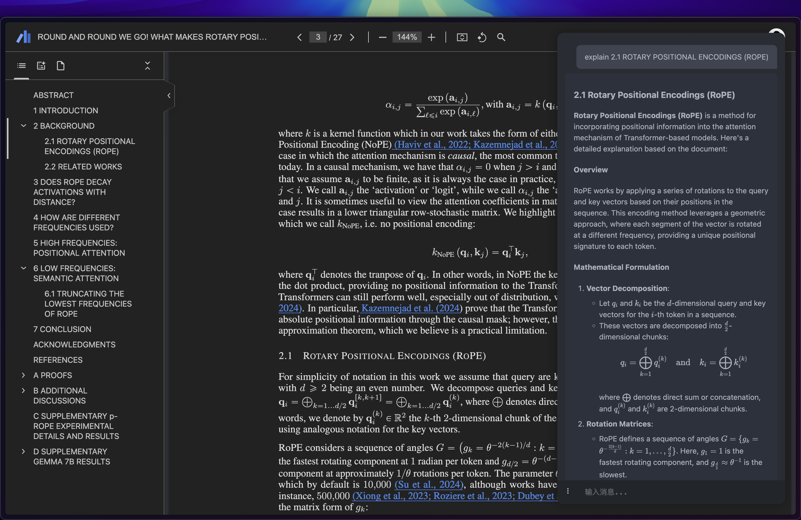

<p align="center">

</p>

<p align="center">
<a href="https://chromewebstore.google.com/detail/cerebr/kjojanemcpiamhohkcpcddpkbnciojkj">
    
</a>
<a href="https://microsoftedge.microsoft.com/addons/detail/cerebr/gafelkdahhgmlccdmpnohckjfkmcdlfe">
    
</a>
<a href="https://addons.mozilla.org/en-US/firefox/addon/cerebr/">
    
</a>
  <a href="https://t.me/uni_api">
    
  </a>
</p>

[English](./README.md) | [简体中文](./README_CN.md)

# 🧠 Cerebr - 智能 AI 助手



Cerebr 是一款强大的浏览器 AI 助手扩展，现已支持 Chrome、Firefox 和 Edge，专注于提升您的工作效率和学习体验。"Cerebr"源自拉丁语词根，与"大脑"或"脑"相关。这个命名体现了我们的愿景：整合 Claude、OpenAI 等 AI 的强大能力，使 Cerebr 成为您的第二大脑，为您提供深度阅读和理解支持。

在尝试了市面上现有的浏览器 AI 助手后，我们发现它们要么有使用次数限制，要么界面过于花哨。Cerebr 应运而生，专注于提供一个简洁、高效、无干扰的 AI 助手体验。

## ✨ 核心特性

- 🎯 **智能侧边栏** - 通过快捷键(Windows: `Alt+Z` / Mac: `Ctrl+Z`)快速唤出,随时随地与 AI 对话
- 🔄 **多 API 支持** - 支持配置多个 API,灵活切换不同的 AI 助手
- 🔁 **配置同步** - 支持跨浏览器的 API 配置同步，轻松在不同设备间共享设置
- 💻 **多平台支持** - 已上架 Chrome、Firefox 和 Edge 商店，在不同浏览器中提供一致的体验。
- 📝 **全能问答** - 支持网页内容问答、PDF 文档问答、图片问答等多种场景
- 🎨 **优雅渲染** - 完美支持 Markdown 文本渲染、LaTeX 数学公式显示
- ⚡ **实时响应** - 采用流式输出,即时获取 AI 回复
- ⏹️ **灵活控制** - 支持在生成过程中随时停止，发送新消息自动停止当前生成
- 🌓 **主题切换** - 支持浅色/深色主题,呵护您的眼睛
- 🌐 **网页版** - 支持网页版，无需安装，通过任何浏览器访问，支持 vercel、GitHub Pages 和 cloudflare pages 部署

## 🛠️ 技术特性

- 💾 **状态持久化** - 自动保存对话历史、侧边栏状态等
- 🔄 **配置同步** - 支持通过浏览器原生同步API实现跨设备配置共享
- 🔍 **智能提取** - 自动识别并提取网页/PDF 内容
- ⌨️ **快捷操作** - 支持快捷键清空聊天(Windows: `Alt+X` / Mac: `Ctrl+X`)、上下键快速调用历史问题
- 🔒 **安全可靠** - 支持多 API Key 管理,数据本地存储
- 🎭 **兼容性强** - 官方支持 Chrome、Firefox、Edge 等主流浏览器，适配各类网页环境。

## 🎮 使用指南

1. 🔑 **配置 API**
   - 点击设置按钮
   - 填写 API Key、Base URL 和模型名称
   - 支持添加多个 API 配置

2. 💬 **开始对话**
   - 使用快捷键 Windows: `Alt+Z` / Mac: `Ctrl+Z` 唤出侧边栏
   - 输入问题并发送
   - 支持图片上传进行图像问答

3. 📚 **网页/PDF 问答**
   - 开启网页问答开关
   - 自动识别并提取当前页面内容
   - 支持 PDF 文件智能问答

## 💡 使用技巧

- ↔️ **调整侧边栏宽度** - 拖动侧边栏左侧边界可调整宽度；双击边界可重置为默认宽度
- ⌨️ **发送消息** - `Enter` 发送，`Shift+Enter` 换行，`Esc` 取消输入框焦点
- ⬆️⬇️ **历史问题回溯** - 输入框为空时，按 `↑`/`↓` 可循环切换最近的问题；在最新一条时再按 `↓` 可回到空输入框
- 📋 **消息菜单** - 对消息右键（触屏设备长按）可复制/重新生成/删除；`Esc` 关闭菜单
- 🖼️ **图片预览** - 点击图片预览大图；按 `Esc` 或点击遮罩关闭

## 🔧 高级功能

- 📋 **右键复制** - 支持右键直接复制消息文本
- 🔄 **历史记录** - 使用上下方向键快速调用历史问题
- ⏹️ **停止生成** - 在生成消息时右键显示停止按钮，可随时中断生成
- 🖼️ **图片预览** - 点击图片可查看大图
- ⚙️ **自定义配置** - 支持自定义快捷键、主题等设置

## 🚀 网页版部署

1. 你可以一键将 Cerebr 的 Web 版本部署到 Fugue：

[](https://fugue.pro/new/repository?repository-url=https%3A%2F%2Fgithub.com%2Fyym68686%2Fcerebr)

2. 你可以一键将 Cerebr 的 Web 版本部署到 Vercel：

[](https://vercel.com/new/clone?repository-url=https%3A%2F%2Fgithub.com%2Fyym68686%2Fcerebr)

3. Cloudflare Pages：连接本仓库，使用 Node.js 24，将**构建命令**设为 `npm run build`，**构建输出目录**设为 `dist`。非 Git 集成构建时需先初始化 `htmd` 子模块。无需服务器或 API 代理。

4. GitHub Pages：Fork 仓库后，在 **Settings → Pages** 中将 Source 设为 **GitHub Actions**。仓库自带工作流会运行测试、Vite 构建并发布 `dist`。相对资源路径支持 `https://<用户名>.github.io/cerebr/` 项目地址。

Vercel 通过 `vercel.json` 使用相同的构建命令与输出目录。发布构建产物，不再直接发布源码目录。API Key 由用户在应用中填写，不应放入 Vite 环境变量。

### Web 版本特点
- 🌐 无需安装，通过任何浏览器访问
- 💻 与 Chrome 扩展版本具有相同的强大功能
- ☁️ 部署自己的实例以获得更好的控制
- 🔒 安全私密的部署方案

## mac 桌面应用

安装 dmg 后，需要执行以下命令：

```bash
sudo xattr -r -d com.apple.quarantine /Applications/Cerebr.app
```

本项目使用 Pake 打包，打包命令如下：

```bash
iconutil -c icns icon.iconset
pake https://xxx/ --name Cerebr --hide-title-bar --icon ./icon.icns
```

https://github.com/tw93/Pake

## 🚀 最新更新

- 🆕 支持图片问答功能
- 🔄 优化网页内容提取算法
- 🐛 修复数学公式渲染问题
- ⚡ 提升整体性能和稳定性

## 📝 开发说明

本项目采用 Chrome Extension Manifest V3 开发,主要技术栈:

- 🎨 React 19 + Vite 7 + CSS
- 📦 Chrome Extension API
- 🔧 PDF.js + MathJax + Marked.js

需要 Node.js 22.12+（CI 使用 24）。本地开发先运行 `npm run build`，然后可以在 Chrome「加载已解压的扩展程序」选择仓库根目录；根目录 manifest 只加载 `dist` 内的编译产物。原来已安装根目录的用户，只需在扩展管理页重新加载 Cerebr，再刷新网页，无需卸载或更换目录。独立分发时构建并打包，安装 `artifacts/chrome` 或 Firefox 对应包。Web 与扩展使用同一套编译后的 React 界面。

```bash
git submodule update --init --recursive
npm ci
npm run dev                  # React + Vite development server
npm run check                # tests and production build
npm run preview              # serve the static dist output
npm run package:extension    # artifacts/cerebr.zip and cerebr-firefox.zip
```

## 🤝 贡献指南

欢迎提交 Issue 进行讨论。为减少维护成本，本项目禁止任何 Feature PR（新增/改进功能）；任何功能增加/改进请移步 Issue 讨论。PR 仅接受 Bug 修复类。

提交 Bug 修复 PR 之前,请确保:

- 🔍 已经搜索过相关的 Issue
- ✅ 遵循现有的代码风格
- 📝 提供清晰的描述和复现步骤

## 📄 许可证

本项目采用 GPLv3 许可证

## 桌面应用

Electron 桌面端位于 `desktop/`，与 Web 和扩展共用 React 界面，支持同机浏览器扩展历史双向同步。开发运行 `npm run dev:desktop`，打包运行 `npm run package:desktop`。详见 [桌面开发、配对和数据说明](docs/desktop.md)。
